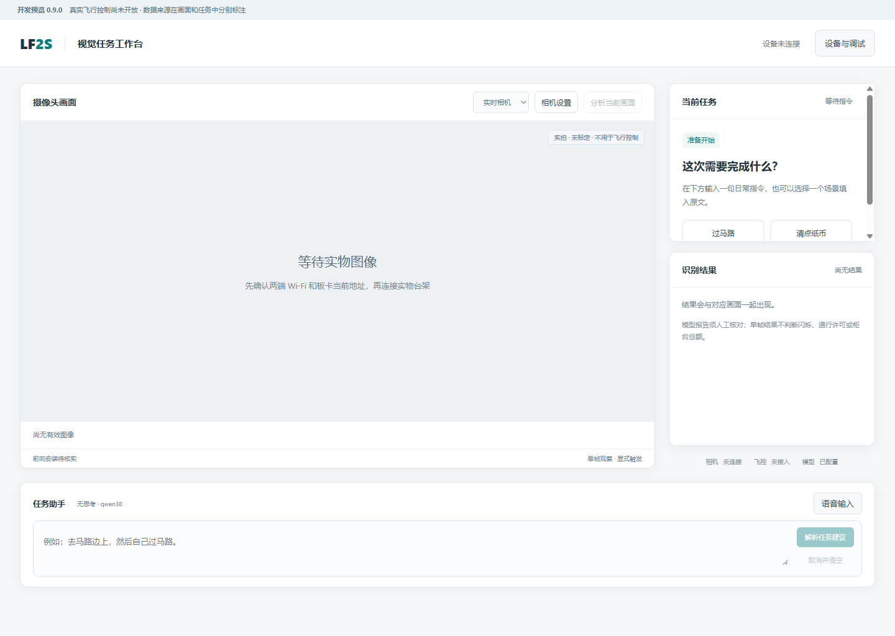

# LF-2S 上位机 · 0.9.0 UART1 真实遥测

0.9.0 增加真实 UART1 只读遥测：连接 ESP32 相机台架后，可以建立独立的 UDP → ESP32 → STM32 UART1 会话。工作台同时显示相机画面和横滚、俯仰、相对偏航；过期样本显示未知。只读会话不提供动作、解锁或飞行控制入口。

使用与接线见 [UART1 真实遥测](docs/13_UART1真实遥测.md)，软件、实物和操作者协助检查以 [UART1 摘要](evidence/uart1-public-summary.json) 分别记录。只读边界针对电脑通信，STM32 保留的本地原厂遥控/PID/电机路径尚未在本阶段验收。

### 0.8.1 矮窗口导航修复

2026-10-18：0.8.1 修复窗口较矮时固定调试侧栏底部导航无法访问的问题，导航区现在可在栏内滚动，并增加 720px 高度下的 Electron 回归。0.8.0 主界面改为明亮工作台，大相机画面居左，任务建议与识别结果居右，文字和语音助手在下方。「设备与调试」保留原有相机设置、飞控 USB、协议诊断、模拟任务、回放和日志。支持过路、视觉寻找路边或收银台、清点平铺人民币纸币的文字建议；场景按钮只填入原文，点击解析后才调用关闭思考的 `qwen38`。详见 [0.8.1 说明](docs/releases/v0.8.1.md) 和 [工作台使用](docs/12_视觉任务工作台.md)。

任务助手生成待审阅流程。已有显式单帧视觉观察开发，当前以本机模型夹具和合成图片验证；连续灯况/闪烁、视觉自主搜索、实景纸币准确率和飞行执行未验收。公司 ASR 未部署。界面、图像、文字或视觉建议均不授予飞机控制许可。

历史 0.7.4：总览新增“飞控协议状态”，直接显示当前会话上报的模式、失效原因、预检、人工锁存、控制者及租期/任务。过期、校验阻断、重启、回放或硬件台架时，当前报告清空为未知；前端失去后台更新也独立清空。协议状态不代表动作已执行或取得实机控制资格。详见[0.7.4说明](docs/releases/v0.7.4.md)。

历史 0.7.3：修复“检测到飞控重启→坏包覆盖原因→延迟旧状态使连接误恢复在线”的问题，重连要求改为独立锁存，并阻断旧状态/结果和请求发送；显式断开、新HELLO及状态确认后才恢复。新增回归使用编译后ARM Flash/UART代码生成的数据，仍属离线软件证据。详见[0.7.3说明](docs/releases/v0.7.3.md)。

历史 0.7.2：ESP32台架改为填写实际板卡地址，支持电脑热点STA与原AP模式；0.1.6固件报告的模式、IPv4、信号和信道在页面显示，旧固件没有报告的项目显示未知。热点重开后需核对DHCP地址，不自动扫描、改电脑网络或跳转到板卡报告的其他地址。详见[0.7.2说明](docs/releases/v0.7.2.md)。

历史 0.7.1：修复撤权后失败END、FAILSAFE最终结果携带`lease_id=0`时被误拒绝、操作留在等待中的问题；仍拒绝其他非零租期、错误任务和缺事件编号的终结结果。已用STM32共同链接ARM函数实际产生的字节回放核对；输入为合成测量，未开放真实控制。详见 [0.7.1说明](docs/releases/v0.7.1.md)。

历史 0.7.0：加入普通话录音/导入、试听、显式提交识别、核对修改转写与填入原文；随后仍需显式解析，只调用无思考 `qwen38`。原文核对与缺参澄清继续保留，没有飞行执行出口。使用见 [普通话录音与转写核对](docs/11_普通话录音与转写核对.md)、[文本建议](docs/10_无思考文本任务建议.md)。公司ASR尚未部署；本机官方样音和Chromium测试麦克风结果不能代替真人普通话准确率。原USB/ESP32台架与S2模拟继续保留，实板证据按版本分别记录；真实MAVLink/UART与飞行尚未接入。

面向自用与教学的 Windows 桌面上位机。ESP32-S3 / OV5640 提供预览和诊断，UART1 提供真实 MAVLink 只读会话和 MPU 姿态，原厂飞控 USB 观察入口继续保留。生产配置、控制坐标/时序与机载执行仍待验证，电脑飞行动作关闭。原 S0–S2 模拟任务与只读回放继续使用独立模拟端点。

Windows 目录包随 GitHub 预览版本发布。本机构建可打开 `release/latest.json` 指向目录里的 `LF2S-Station.exe`。详见 [实物台架使用说明](docs/06_ESP32实物台架.md)；实际通过范围见验收报告。

[版本与下载](https://github.com/lwhguge-dot/LF-2S/releases) · [验收报告](evidence/验收报告.md) · [后续计划](docs/03_验收与后续计划.md) · [MIT 许可证](LICENSE)



## 直接运行 Windows 目录包

从 [版本下载](https://github.com/lwhguge-dot/LF-2S/releases) 获取对应版本的 Windows ZIP；本机以 `release/latest.json` 为准。完整解压并保留整个目录；无需另装 Node 或 Python。软件未签名，尚无安装器。

打开默认进入工作台。相机设置、飞控 USB 与下述模拟/回放功能从右上角「设备与调试」进入；返回工作台保留原文，清除旧建议并重新核对。图像来源可选实时相机或明确标注的本机合成图像，两者与识别结果分别管理。

0.4.0 连续预览按请求完成情况读取下一张图，最多一个在途请求；可选择上限 10/5 FPS 或 1 FPS 静态查看，并显示实际显示帧率、请求至显示耗时、JPEG 大小和板端等帧时间。配合 0.1.5 固件，可切换 320×240 / 640×480 / 800×600 与自动/室内白平衡。默认使用自动白平衡；参数结果不明确时须重连，不自动重复设置。实测与画质说明见 [图传帧率与画质](docs/08_图传帧率与画质.md)。

0.3.1 修复预览传输偶尔超过 2 秒后被永久判为断开的故障：显示请求允许最多 6 秒，临时异常清空画面并最多核对三次当前流，成功后继续预览；板卡重启/流变化、身份和 JPEG 校验错误仍须手动重连，对焦命令不自动重发。详见 [稳定性排查记录](docs/07_预览稳定性排查.md)。

本机构建产物位于 release/，多次构建时以 release/latest.json 为准。

「ESP32 实物台架」：测试阶段让ESP32连接电脑的2.4GHz移动热点，电脑继续上网；若上游为手机热点，也使用2.4GHz。在输入框填写电脑热点设备列表或板卡串口显示的实际IPv4，再点击「连接实物台架」。热点重开后地址可能变化。原板卡AP模式仍可使用其实际地址连接。USB继续供电，图像通过Wi-Fi传输。兼容固件 0.1.3 及以上的 0.1.x 相机台架配置，参数调整需要 0.1.5；不在应用内保存热点密码。连接实物会断开模拟会话；断开实物后才能继续模拟。打开回放会关闭实物输入，退出不自动重连。

1. 「监控总览」连接模拟设备、读取配置，检查合成 JPEG、数值、未知、过期、指纹和来源校验。默认监控配置未签认。
2. 「模拟任务」点击「重置并准备模拟器」，再「连接任务模拟器」「读取模拟任务配置」。此操作显式更换模拟 boot；仅模型取得测试资格，生产配置仍未签认。
3. 勾选本次模拟许可并启动：PERMIT → ACQUIRE → BEGIN → 模拟起飞至 0.50 m → 保持 → 降落上锁 → END → RELEASE。最终完成依赖新合成样本及对应最终协议结果。每次都需重新勾选；没有自动重做任务。
4. 在总览切换断链、传感器冻结、定位重置、结果丢失、人工接管或重启，观察任务中断；结果未知只能「查询原请求结果」。查询单个结果不会继续旧流程或宣布整项任务完成。
5. 「只读回放」刷新并选录制，打开、拖动时间轴或播放。打开会断开实时会话；回放不能连接、发任务或改变场景，退出后保持断开。显示录制时的有效性与年龄。图像仅录元数据，不用实时图像冒充历史图像。
6. 「协议详情」「事件日志」查看完整 u64、请求关联与原始字段。关闭窗口会清理后台；后台退出、重启、刷新和重连均不恢复旧动作。

模拟页面标明合成来源；实物相机和 UART1 分别显示连接状态，电脑真实控制入口始终关闭。未知、无效或过期值显示「未知」，JSON 为 null；有效地面高度 0 可以是合成样本。实物预览和合成图像均不能用于真实视觉控制。原遥控接管在模型内同样优先并锁存，恢复健康场景或重连不能清除；显式重置整个模拟器才开始新测试启动代数。空中人工状态可能拒绝新 HELLO，这不代表锁存解除。

## 开发和复验

准备 Windows x64、PowerShell 7、Git、Node 26.8.2、npm 11.19.1 和 uv 0.12.19。uv 会在需要时获取 Python 3.12.14；初次恢复依赖需要联网。开发环境版本已经锁定，用户目录包不依赖这些工具。

在 PowerShell 7 克隆并进入仓库根目录：

```powershell
git clone https://github.com/lwhguge-dot/LF-2S.git
Set-Location LF-2S
```

随后运行：

```powershell
# 初次恢复独立依赖
& './scripts/Station.ps1' setup
& './scripts/Station.ps1' dev

# Python/协议副本/类型/实际桌面验收
& './scripts/Station.ps1' check

# 冻结 Python 并制作自带 Electron/Python 的 Windows 目录包
& './scripts/Station.ps1' package
& './scripts/Station.ps1' verify-package

# 根据本次运行结果生成公开摘要，并更新包内文档及清单
& './.venv/Scripts/python.exe' -B scripts/report.py
& './.venv/Scripts/python.exe' -B scripts/package.py --refresh-docs

# 制作完整 ZIP，再解压并实际运行整组桌面验收
& './scripts/Station.ps1' archive
& './scripts/Station.ps1' verify-archive
```

当前 Node 26 尚未进入 LTS，固定上述版本构建。Python 依赖在 .venv，npm 依赖在本目录 node_modules；requirements 锁含哈希，package-lock.json 含包完整性。Playwright 随本仓库开发依赖安装，直接驱动 Electron，无需另下载浏览器。协议检查不依赖外部研发工作区。

原研发工作区的同一工程在 `P1/05_上位机`，运行上述命令前进入该目录即可。发布与后续版本工作流见 [开源与发布](docs/04_开源与发布.md)。

应用日志位于 `%APPDATA%/LF2SStation/logs`，界面能打开该目录。JSONL 每份最大 2 MiB，保留当前文件和 3 份备份；桌面日志单份约 512 KiB，保留 1 份备份。界面最近 240 条；遥测日志最多 1 Hz。录制在同级 `recordings`：最多 2 Hz 快照、256 条写队列，单次运行最多 4 MiB、保留最近 6 份，满后停止该份录制并报告丢弃。磁盘写入使用独立线程；回放读取有限大小文件，不占用 UDP 调度。测试使用 `.work/qa-*` 独立用户目录。

## 文件入口

- `docs/01_需求与状态契约.md`：状态、有效性、编号和只读边界。
- `docs/02_接口与生命周期.md`：API、IPC、服务凭据、进程清理。
- `docs/03_验收与后续计划.md`：S0–S2 验收与 S3–S5 入口。
- `evidence/验收报告.md`：实际运行结果和限制；JSON/JUnit/截图为可检查证据。
- `protocol/manifest.json`：现有协议源码的受控副本及逐文件 SHA-256。
- `THIRD_PARTY.md`：依赖与来源说明。
- `docs/04_开源与发布.md`：本机发布与 GitHub Actions；普通推送执行检查，手动选择标签可发布预览版本。
- `docs/05_S2模拟任务与回放.md`：固定模拟动作、完成条件、权限、未知结果与录制容量策略。

自有代码采用 MIT。第三方依赖保留原许可；不包含商家原件、机载固件、模型、凭据和本机开发环境。

NSIS 安装/升级/卸载、干净 Windows 机器、相机光学时序与标定、真人语音/实景识别准确率、NRF 业务和飞行仍待后续。UART1 只读遥测与相机实测范围独立记录；S3 整体和 S4–S5 尚未完成。
