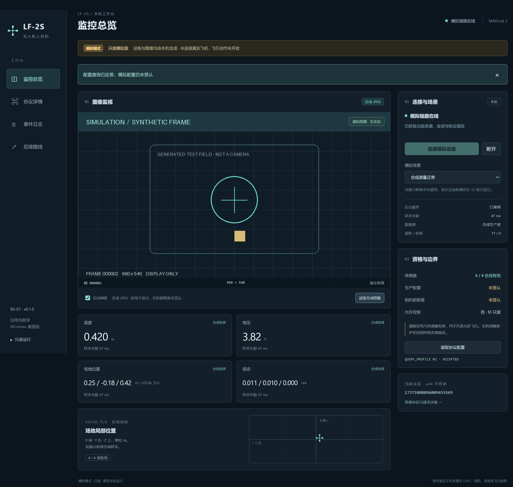

# LF-2S 上位机 · 0.1.0 只读模拟版

面向自用与教学的 Windows 桌面上位机。当前交付 S0–S1：Electron + Vue 3 / TypeScript + Python / FastAPI。本机三个真实 UDP 端点串联 PC 适配器、模拟 ESP32 网关和 FCModel，复用现有 MAVLink 2 协议。当前全部设备和测量为明确标记的合成模拟，没有连接真实飞机。

[版本与下载](https://github.com/lwhguge-dot/LF-2S/releases) · [验收报告](evidence/验收报告.md) · [后续计划](docs/03_验收与后续计划.md) · [MIT 许可证](LICENSE)



## 直接运行 Windows 目录包

从 Releases 下载 `LF2S-Station-0.1.0-win-x64.zip`，完整解压后打开其中的 `LF2S-Station.exe`。整个目录必须一起保留；无需另装 Node 或 Python。附带 `.sha256`、逐文件 `.manifest.json` 和 ZIP 解压后实际运行的 `.verification.json`。软件未签名，尚无安装器。

本机构建产物位于 release/，多次构建时以 release/latest.json 为准。

1. 点击「连接模拟设备」：发送 HELLO，建立新的只读会话。
2. 点击「读取协议配置」：通过 UDP 查询模拟配置；生产配置始终未签认。
3. 查看合成 JPEG、合成高度/电压/位置/姿态；切换场景检查未知、过期、错误来源/指纹和重启。
4. 「协议详情」查看完整十进制会话编号和配置，「事件日志」可展开原始协议字段和请求关联号。
5. 关闭窗口会清理自己拥有的后台；后台异常退出时，界面使所有测量失效，可手动重启后台并重新连接。

所有页面持续标明模拟模式。未知、无效或过期值显示「未知」，JSON 为 null；不把默认 0 装成测量。合成图像不能用于真实视觉控制。没有起飞、解锁、任务或控制权入口。

## 开发和复验

准备 Windows x64、PowerShell 7、Git、Node 26.8.2、npm 11.19.1 和 uv 0.12.19。uv 会在需要时获取 Python 3.12.14；初次恢复依赖需要联网。开发环境版本已经锁定，用户目录包不依赖这些工具。

在 PowerShell 7 克隆并进入仓库根目录：

```powershell
git clone https://github.com/lwhguge-dot/LF-2S.git
Set-Location LF-2S
```

随后运行：

```powershell
# 初次恢复独立依赖
& './scripts/Station.ps1' setup
& './scripts/Station.ps1' dev

# Python/协议副本/类型/实际桌面验收
& './scripts/Station.ps1' check

# 冻结 Python 并制作自带 Electron/Python 的 Windows 目录包
& './scripts/Station.ps1' package
& './scripts/Station.ps1' verify-package

# 根据本次运行结果生成公开摘要，并更新包内文档及清单
& './.venv/Scripts/python.exe' -B scripts/report.py
& './.venv/Scripts/python.exe' -B scripts/package.py --refresh-docs

# 制作完整 ZIP，再解压并实际运行整组桌面验收
& './scripts/Station.ps1' archive
& './scripts/Station.ps1' verify-archive
```

当前 Node 26 尚未进入 LTS，固定上述版本构建。Python 依赖在 .venv，npm 依赖在本目录 node_modules；requirements 锁含哈希，package-lock.json 含包完整性。Playwright 随本仓库开发依赖安装，直接驱动 Electron，无需另下载浏览器。协议检查不依赖外部研发工作区。

原研发工作区的同一工程在 `P1/05_上位机`，运行上述命令前进入该目录即可。发布与后续版本工作流见 [开源与发布](docs/04_开源与发布.md)。

应用日志位于 `%APPDATA%/LF2SStation/logs`，界面能打开该目录。JSONL 每份最大 2 MiB，保留当前文件和 3 份备份；桌面日志单份约 512 KiB，保留 1 份备份。界面最近 240 条；遥测日志降采样到 1 Hz。测试使用 `.work/qa-*` 独立用户目录。

## 文件入口

- `docs/01_需求与状态契约.md`：状态、有效性、编号和只读边界。
- `docs/02_接口与生命周期.md`：API、IPC、服务凭据、进程清理。
- `docs/03_验收与后续计划.md`：S0–S1 验收与 S2–S5 入口。
- `evidence/验收报告.md`：实际运行结果和限制；JSON/JUnit/截图为可检查证据。
- `protocol/manifest.json`：现有协议源码的受控副本及逐文件 SHA-256。
- `THIRD_PARTY.md`：依赖与来源说明。
- `docs/04_开源与发布.md`：本机发布与 GitHub Actions；普通推送执行检查，手动选择标签可发布预览版本。

自有代码采用 MIT。第三方依赖保留原许可；不包含商家原件、机载固件、模型、凭据和本机开发环境。

NSIS 安装/升级/卸载、干净 Windows 机器、真实 UART/ESP32/STM32、相机、语音、视觉、NRF 与飞行均不属于本轮已完成验收。S2–S5 保留，见计划；本版不是全部系统完成。
